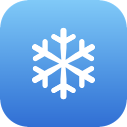

<div align="center">
  
  <h1>ClimateBar</h1>
  <p>Control your Midea air conditioners from the macOS menu bar — over your local network.</p>
</div>

ClimateBar speaks the Midea V3 LAN protocol directly (ported from
[midea-local](https://github.com/midea-lan/midea-local)): a thermostat dial, fan
control, and on/off, in a SwiftUI menu bar panel with Liquid Glass. After a
one-time sign-in it talks to your ACs **only over your LAN** — the cloud is never
contacted again.

<!-- Screenshots: drop panel.png and onboarding.png into docs/ and they'll show here. -->

## Install

```sh
brew install --cask spiercer/tap/climatebar
```

Signed and notarized by Apple — it just opens, no Gatekeeper warning. The first
time it connects, macOS asks to let ClimateBar **"find devices on your local
network"** — click **Allow**, or it can't reach your ACs.

Not on Homebrew? Grab the `.zip` from the
[latest release](https://github.com/SPiercer/climate_bar/releases/latest), unzip,
and move `ClimateBar.app` to your Applications folder.

## Setup

On first launch the panel shows a sign-in form. Enter your **Midea account**
(the one you paired the ACs with in the MSmartHome app). ClimateBar then:

1. logs into the Midea cloud **once** to fetch each AC's LAN `token`/`key`,
2. discovers your ACs on the network,
3. verifies each key against the actual unit, and saves them locally.

That's it — from then on it's LAN-only. It also **re-scans the LAN periodically**,
so an AC that reboots onto a new DHCP address or comes back online is picked up
automatically without re-doing setup.

> **Why a cloud sign-in at all?** Protocol-3 units require a per-device
> `token`/`key` for LAN control, and Midea only issues those from their cloud at
> pairing time. ClimateBar fetches them once, then you can firewall the units off
> the internet entirely.

Tokens and keys live in `~/Library/Application Support/ClimateBar/devices.json`
(chmod 600) — they're device secrets, never committed, never sent anywhere but
your ACs.

## Requirements

- macOS 26+ (the panel uses Liquid Glass)
- Your ACs on the same LAN as your Mac, already paired in the MSmartHome app

## Build from source

```sh
./Scripts/bundle.sh        # builds build/ClimateBar.app (signed if a Developer ID cert is present, else ad-hoc)
open build/ClimateBar.app
```

> Test with the built **app bundle**, not `swift run` — a bare binary is blocked
> from the LAN by macOS's Local Network privacy, so connections fail. The bundle
> gets the permission prompt.

Other scripts: `Scripts/release.sh <version>` cuts a signed+notarized release and
updates the Homebrew cask; `Scripts/make_icon.sh` regenerates the app icon.

## Command-line tools (optional, Python)

Power-user scripts that reuse the same local protocol and `devices.json`. Run
them with a Python that has [`midealocal`](https://pypi.org/project/midea-local/)
installed (`pipx install midea-local`):

| Tool | Does |
|------|------|
| `ac.py list` | Show each AC and its state |
| `ac.py on\|off <ac>` | Power an AC on/off (`<ac>` is a number, IP, or `all`) |
| `ac.py temp 24 <ac>` | Set target temperature |
| `ac_direct.py <ip> on\|off\|26` | Send a single raw command to one AC by IP |
| `ac_setup.py` | Generate `devices.json` from the terminal instead of the in-app login |

## Credits

Protocol ported from [midea-local](https://github.com/midea-lan/midea-local)
(see `NOTICE`). Licensed under Apache-2.0.
